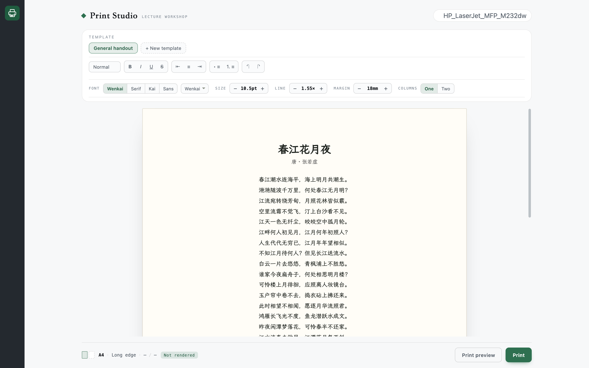

[中文](./README.zh-CN.md) | **English**

# Print Studio · dsh-doc

[](https://www.npmjs.com/package/@polunzh/dsh-doc)
[](https://dshopen.org/zh/plugins/@polunzh/dsh-doc/)
[](https://dsh.127.dev/)
[](LICENSE)

A Word-like desktop for typesetting and duplex printing handouts on local network printers directly from DeepSeek Harness.



## Highlights

- **Word-like A4 desk**: write or paste directly on an authentic A4 canvas with live margins, fonts, line spacing, and column formatting.
- **Ribbon toolbar**: formatting strip with headings, inline styles, alignments, lists, and instant typographic stepping.
- **Verified pagination**: groups questions and options into break-safe blocks to avoid splitting questions across pages.
- **LAN capability probing**: reads real PPD and IPP printer parameters (duplex, paper size, grayscale) and maps them cleanly without guesswork.
- **On-demand proofing**: click **Print preview** to inspect accurate page layouts and layout rule checks rendered via Chromium CDP before committing to paper.
- **Agent ready**: ships the `print_handout` tool for direct LLM automation without opening the UI.

## Install

```bash
dsh plugin --profile desktop add @polunzh/dsh-doc
```

Requires local Chrome/Chromium for PDF rendering. Page thumbnails require `poppler` (`brew install poppler` on macOS, `apt install poppler-utils` on Linux).

## License

MIT
