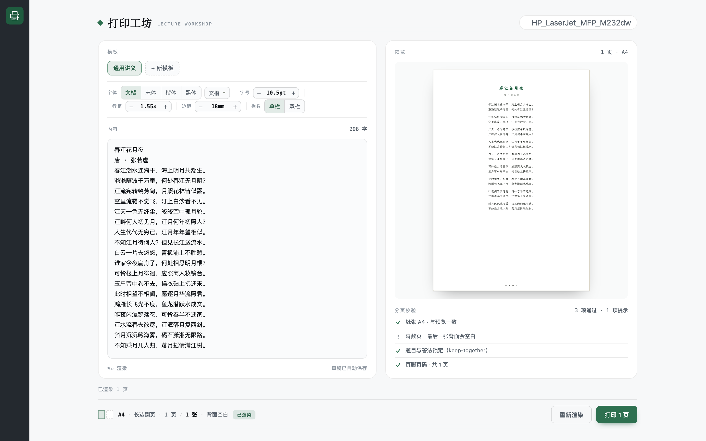

**中文** | [English](./README.md)

# 打印工坊 · dsh-doc

把 Markdown 排成可直接打印的 A4 讲义，探测局域网打印机的真实能力后投递，并回报队列是否真的出纸。



## 它在解决什么

手工做一份讲义通常要三步：排版、确认分页没把题目和答案拆开、最后打出来。第三步看着最简单，实际最容易踩坑——每台打印机的双面选项叫法不同（PPD 驱动是 `Duplex=DuplexNoTumble`，IPP Everywhere 是 `sides=two-sided-long-edge`），而且「任务已提交」不等于「纸出来了」。

这个插件把链路收成一条：

```
Markdown/文本 ──► 打印样式 HTML ──► Chrome headless ──► A4 PDF
                                                          │
                                          按 lpoptions 实测能力映射参数
                                                          ▼
                                             lp 提交 ──► lpstat 轮询 ──► 回执
```

## 能力

- **能力探测**：读 `lpstat -p -d` / `lpstat -v` / `lpoptions -l`，把 PPD 原文解析成「这台机器支持哪些双面 / 纸张 / 颜色值」的结构化能力表，而不是让调用方猜关键字。
- **参数映射**：双面意图（长边 / 短边 / 单面）按机器实际选项名落地；映射不了的就明确报告 `skipped`，不假装生效。
- **渲染即校验**：Markdown 里「编号问题 + A/B 答法」会被包进同一个 `.qa` 容器，打印时整体 `break-inside: avoid`——题目和答案不会被分页撕开。
- **纸张分摊**：按页数与双面模式算出用纸张数，奇数页会提前提示「最后一张背面空白」。
- **出纸回执**：`lp` 提交后轮询 `lpstat -W completed`，区分 `processing` / `completed` / `unknown`。`unknown` 会明说不确定，不会谎报成功。
- **真实页码**：页脚通过 CDP（`Page.printToPDF` 的 `footerTemplate`）绘制，因为 Chromium 的 `@page` 边距盒不支持 `counter(page)`。CDP 不可用时退回 `--print-to-pdf`，页码缺失，并在分页校验里明确标出。

## 安装

从 npm 装：

```bash
dsh plugin --profile desktop add @polunzh/dsh-doc
```

从本地源码装（开发用），走 Plugin Manager：

```text
plugin_manager(install_bundle, target="<本仓库路径>")
```

本机需要有 Chrome 或 Chromium。预览缩略图依赖 poppler 的 `pdftoppm` / `pdfinfo`（macOS：`brew install poppler`，Debian/Ubuntu：`apt install poppler-utils`）；缺了仍能渲染，只是没有缩略图。

## 使用

1. 左侧栏点「打印工坊」图标进入面板。
2. 选模板，把内容贴进编辑器。
3. `⌘↵` 或点「渲染」——右侧出现分页缩略图与分页校验。
4. 点「打印 N 页」→ 确认卡 → 正式打印。
5. 底部状态条回报任务：处理中 → 已完成 · N 页 / M 张。

面板上常驻一条排版控制条，改任意一项都会在 250ms 后重渲预览：

| 控件 | 范围 |
| --- | --- |
| 字体 | 四个预设，外加对本机全部已装字体的检索 |
| 字号 | 8.5 – 18 pt，步进 0.5 pt |
| 行距 | 1.2 – 2.4，步进 0.05 |
| 边距 | 8 – 35 mm，步进 2 mm |
| 栏数 | 单栏 / 双栏 |

调整即时预览但不自动保存：控制条上出现「未保存」与「保存 / 撤销」。保存写回当前模板；内置模板以覆盖项形式存储，随时可恢复默认。

## 字体

内置四个预设：`wenkai`（霞鹜文楷，默认）、`song`（宋体）、`kaiti`（楷体）、`system`（黑体 / PingFang SC）。预设之外，字体按钮可以打开系统字体检索——宿主按平台枚举本机已装字体（macOS 走 AppKit，Linux 走 fontconfig，Windows 走注册表），同时匹配家族名与本地化别名，所以 `wenkai`、`霞鹜`、`文楷` 都能命中同一条 `LXGW WenKai`。字体栈都带回退，没装文楷时自动落到宋体，不会排成豆腐块。

装文楷（SIL OFL 1.1，可自由使用与再分发）：

```bash
curl -L -o ~/Library/Fonts/LXGWWenKai-Regular.ttf \
  https://github.com/lxgw/LxgwWenKai/releases/download/v1.530/LXGWWenKai-Regular.ttf
```

## 模板

模板是「可存储的版式参数」，不是硬编码样式：

| 字段 | 说明 | 范围 |
| --- | --- | --- |
| `title` | 模板名，显示在 chip 上 | ≤ 40 字 |
| `subtitle` | 印在文档标题下方的一行说明 | ≤ 120 字 |
| `accent` | 标题 / 序号 / 分隔线主色 | `#rrggbb` |
| `font` | 正文字体 | 预设 id，或任意已装字体家族 |
| `fontSize` | 正文字号，整篇等比缩放 | 8.5 – 18 pt |
| `lineHeight` | 行距倍率 | 1.2 – 2.4 |
| `margin` | 页面边距 | 8 – 32 mm |
| `columns` | 单栏 / 双栏 | 1 或 2 |

自定义模板存到 `~/.dsh/storages/dsh-doc/templates.json`，重启不丢。`render` 也接受一次性的 `style` 覆盖，只影响本次渲染、不动已保存模板：`{markdown, template, style: {font, fontSize, lineHeight, margin, columns}}`。

## 宿主路由

| 方法 | 路径 | 说明 |
| --- | --- | --- |
| GET | `/dsh-doc/api/status` | 打印队列、能力、默认值、Chrome 可用性、系统字体、已存草稿 |
| GET | `/dsh-doc/api/fonts` | `{fonts, aliases}`——本机字体家族名与中英别名表 |
| POST | `/dsh-doc/api/render` | `{markdown, template, title}` → 页数、张数、校验、预览图 |
| POST | `/dsh-doc/api/print` | `{id, printer?, duplex?, copies?, media?, color?}` → 任务 id |
| GET | `/dsh-doc/api/job?queue=&id=` | 任务状态 processing / completed / unknown |
| POST | `/dsh-doc/api/templates` | `create` / `update` / `reset` / `delete` |
| POST | `/dsh-doc/api/draft` | 保存草稿；`/status` 的 `draft` 字段回读 |

所有路由都先过宿主 `connection.requestRejection` 守卫，守卫缺失时 fail-closed。写路由要求 `application/json`，跨站表单发不出写请求。

## Agent 工具

宿主注册了 `print_handout`，模型可以不走面板、直接驱动同一条链路：

| Action | 行为 |
| --- | --- |
| `printers` | 列出队列、默认打印机、双面 / 彩色能力（只读） |
| `render` | 渲染 PDF，返回页数、用纸张数、分页校验——不打印 |
| `print` | 真的出纸，不可撤回；用 `id` 复用渲染，或传 `markdown` 现场渲染 |
| `status` | 查询已提交任务的状态 |

典型用法是先 `render` 看页数与校验，确认后 `print`。工具返回英文文本；面板的分页校验按语义码在本地渲染。

## 配置

可选，写在 `cordis.patch.yml` 插件行的 `config` 块：

```yaml
duplex: long      # long | short | none
color: gray       # gray | color
media: A4
copies: 1
chromePath: null  # null 时自动探测
```

## 草稿

编辑器内容自动存到 `~/.dsh/storages/dsh-doc/draft.json`（800ms 防抖，原子写入）。存宿主侧而不是浏览器 `localStorage`，是因为 Web GUI 每次启动端口不同，而 `localStorage` 按 origin（含端口）隔离——换端口就等于换仓库，草稿会凭空消失。

## 界面语言

面板支持中文 / English / 日本語，随宿主语言（`navigator.language`）切换，默认英文。分页校验返回语义码加参数（如 `guard.duplexOdd` + `{pages, sheets}`），由界面按语言渲染，因此 Agent 工具拿英文文本、面板保持本地化。宿主侧错误信息为英文。

## 已知边界

- 需要本机有 Chrome / Chromium；没有时渲染给出明确错误，而不是退回低保真转换。
- 页码依赖 CDP。CDP 不可用时 PDF 正常产出但没有页码，`guard.pageNumbersMissing` 会标出。
- Chrome 自动探测只覆盖 macOS 与 Linux 路径；Windows 需显式设置 `chromePath`。
- 只探测本机 CUPS 队列；远程打印机需要先在系统里添加。
- 回执的 `completed` 是队列层面的确认，不构成物理出纸证明。
- docx 输入不在范围内：本插件只认 Markdown 与纯文本。

## 开发

```bash
npm test        # 61 项：解析、映射、分页校验、路由、工具 schema
npm run screenshot   # 用真实的 lib/client.js 重新生成 preview/screenshots
```

## 许可证

MIT
