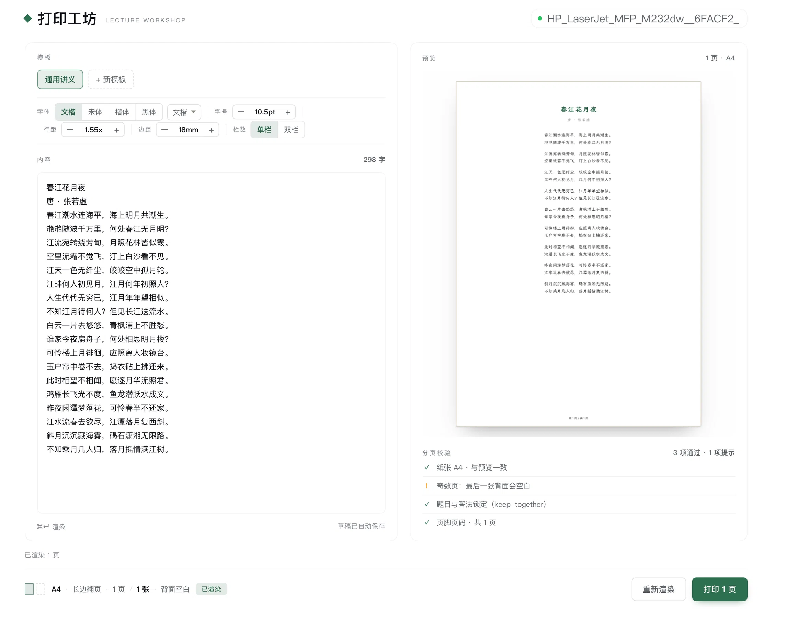

**中文** | [English](./README.md)

# 打印工坊 · dsh-doc

把一段文字排成讲义，并直接打印到局域网打印机：模板负责版式，渲染负责分页，你确认后出纸。



## 它在解决什么

手工做一份讲义通常要三步：排版成 Word/PDF、确认分页没有把题目和答案拆开、最后打出来。第三步看着最简单，实际上最容易踩坑——每台打印机的双面选项叫法不同（PPD 驱动是 `Duplex=DuplexNoTumble`，IPP Everywhere 是 `sides=two-sided-long-edge`），而且「任务已提交」并不等于「纸出来了」。

这个插件把链路收成一条：

```
Markdown/文本 ──► 打印样式 HTML ──► Chrome headless ──► A4 PDF
                                                        │
                                         按 lpoptions 实测能力映射参数
                                                        ▼
                                           lp 提交 ──► lpstat 轮询 ──► 回执
```

## 能力

- **能力探测**：读 `lpstat -p -d` / `lpstat -v` / `lpoptions -l`，把 PPD 原文解析成「这台机器支持哪些双面/纸张/颜色值」的结构化能力表，而不是让调用方猜关键字。
- **参数映射**：双面意图（长边/短边/单面）按机器实际选项名落地；映射不了的就明确报告 `skipped`，不假装生效。
- **渲染即校验**：Markdown 里「编号问题 + A/B 答法」会被包进同一个 `.qa` 容器，打印时整体 `break-inside: avoid`——题目和答案不会被分页撕开。
- **纸张分摊**：按页数与双面模式算出用纸张数，奇数页会提前提示「最后一张背面空白」。
- **出纸回执**：`lp` 提交后轮询 `lpstat -W completed`，区分 `processing` / `completed` / `unknown`（`unknown` 会明说不确定，不会谎报成功）。

## 安装

插件以本地目录 bundle 安装（Plugin Manager 会链接本目录并写入 profile）：

```text
plugin_manager(install_bundle, target="/Users/zhenqiang/Documents/project/dsh-plugins/dsh-doc")
```

装好后左侧栏出现「打印工坊」图标；面板页在中央区域。

## 使用

1. 左侧栏点「打印工坊」图标进入面板。
2. 选模板，把内容贴进编辑器。
3. `⌘↵` 或点「渲染预览」，右侧看到分页缩略图与校验条目。
4. 点「打印 N 页」→ 确认卡 → 正式打印。
5. 底部状态条回报任务：处理中 → 已完成 · N 页 / M 张。

## Agent 工具

宿主注册了 `print_handout`，模型可以直接调用：

| Action | 行为 |
| --- | --- |
| `printers` | 列出队列、默认打印机、能力（只读） |
| `render` | 渲染 PDF，返回页数、用纸张数、校验（不打印） |
| `print` | 真的出纸，不可撤回 |
| `status` | 查询任务状态 |

## 已知边界

- 需要本机有 Chrome / Chromium（用 `--headless=new --print-to-pdf`）。
- 页脚页码暂未实现：Chromium 的 `@page` 边距盒不支持 `counter(page)`。
- 只探测本机 CUPS 队列；远程打印机需要先在系统里添加。
- 回执的「completed」是队列层面的确认，不构成物理出纸证明。
